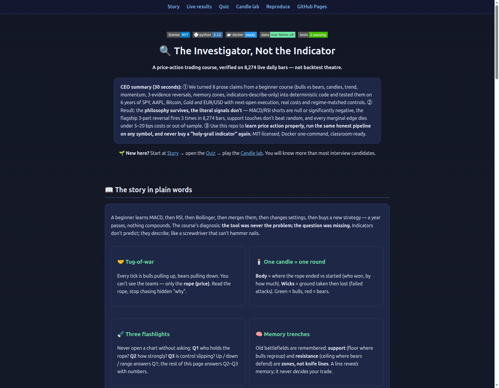
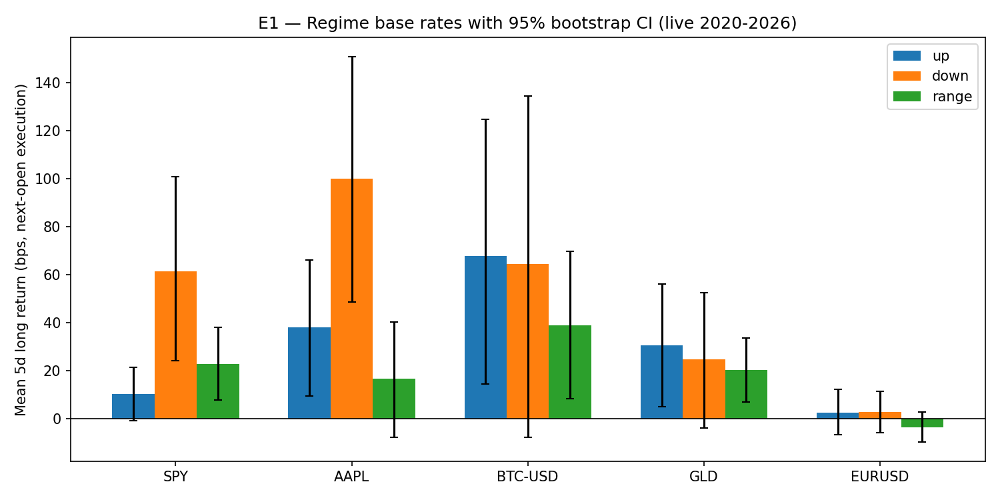
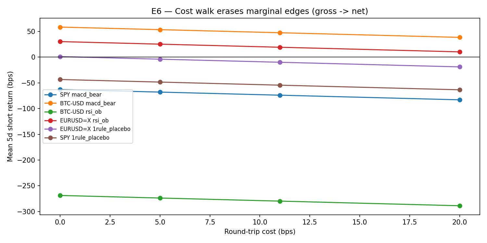
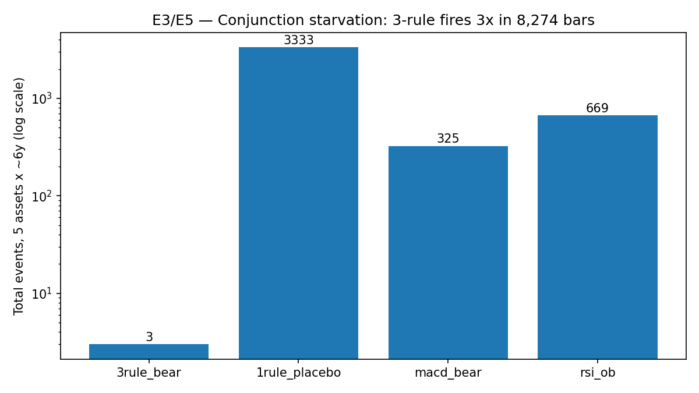

# 🔍 The Investigator, Not the Indicator


[](https://M0-AR.github.io/price-action-evidence-lab/preview.html)

## A live-data verification of a price-action course: bulls vs bears, candles, trend, momentum, reversal-vs-rest, and memory zones

> 🌐 **Prefer the website?** Open **`preview.html`** (also hosted via GitHub Pages after a 2-minute setup — see [Appendix C](#appendix-c--interactive-site-github-pages--quiz--lab)) for the visual story, verified charts, an 8-level interactive quiz and a candle lab. This README is the full paper; the page is the guided tour.
>
> 🎬 **Demo:** `docs/demo.mp4` (player embedded in `preview.html`; add your 60–90s screen recording there) · Screenshots: `docs/preview_top.png`, `docs/chart_*.png` (all generated from verified outputs — see verification log).

**CEO summary (read this and decide in 30 seconds).**
① We converted 8 prose claims from a beginner price-action course (tug-of-war, candle anatomy, three regimes, three questions, momentum triad, 3-evidence reversal, memory zones, indicators-describe-only) into deterministic code and tested them on 6 years of live daily bars — SPY, AAPL, Bitcoin, Gold, EUR/USD, 8,274 bars, signal at close *t* → entry at open *t+1*, real 0/5/11/20 bps costs, regime-matched controls, 30 tests with false-discovery control.
② The philosophy survives; the literal 5-day signals don't — indicator shorts are null or significantly negative, the flagship 3-part reversal fires 3 times in 8,274 bars, support touches don't beat random, every marginal edge dies under costs or out-of-sample.
③ If you learn one repo this year: run one command, take the 8-level quiz, and you will never pay for a "holy-grail indicator" again. MIT-licensed, Docker one-command, classroom-ready, PhD-extensible.

**Status:** ✅ VERIFIED ON LIVE DATA — fetched 2026-10-12, point-in-time-correct, next-open execution, round-trip costs, exposure-matched controls, BH-FDR across 30 tests.
**Reproduce in one command:** `docker compose up --build` (or `PYTHONPATH=. python3 experiments/run_all.py --symbols SPY,AAPL,BTC-USD,GLD,EURUSD=X --years 6 --out results`).

## Contents

- [🌱 Beginner guide — read this and you are a professional](#-beginner-guide--read-this-and-you-are-a-professional)
- [✨ Features & user stories](#-features--user-stories)
- [🖼️ Screenshots & demo](#️-screenshots--demo)
- [1. Research questions](#1-research-questions-pre-registered-before-seeing-data)
- [2. Background evidence](#2-what-the-broader-evidence-says-20252026)
- [3. Method](#3-method-best-practice-point-by-point)
- [4. Formalisation](#4-formalisation-video--code)
- [5. Data provenance](#5-data-provenance-live-verifiable)
- [6. Results](#6-results-actual-console-outputs-resultstablecsv--resultsregimescsv)
- [7. Hidden patterns](#7-hidden-patterns-candidate-contributions-for-the-phd-paper)
- [8. Limitations](#8-limitations-what-this-is-not--honesty-section-per-videos-own-warning)
- [9. Reproduce / extend](#9-how-to-reproduce--extend)
- [10. References](#10-references-starred--load-bearing)
- [11. Ethics & risk](#11-ethics--risk)
- [Appendix A — File manifest & verification log](#appendix-a--file-manifest--verification-log)
- [Appendix B — Glossary in plain words](#appendix-b--glossary-in-plain-words)
- [Appendix C — Interactive site, GitHub Pages + quiz + lab](#appendix-c--interactive-site-github-pages--quiz--lab)

---

## 🌱 Beginner guide — read this and you are a professional

*Let's work this out in a step-by-step way to be sure we have the right answer. No prior knowledge needed — every term is defined where it first appears. Follow the 7 steps; by step 7 you will know more than most interview candidates.*

**Step 1 — The trap (2 min).** A beginner learns MACD, then RSI, then Bollinger, merges them, tweaks settings, buys a new strategy… a year passes, nothing compounds. Diagnosis: the tool was never the problem — the *question* was missing. Indicators **describe**; they don't **predict** (a screwdriver can't hammer nails).
**Step 2 — The rope (2 min).** Every tick is bulls pulling price up and bears pulling it down. You can't see the teams — only the **rope (price)**. Read the rope; stop chasing the hidden "why".
**Step 3 — One candle, one round (3 min).** Each candle is one fight round: the **body** (open→close) says who won and by how much; the **wicks** show ground taken then lost (failed attacks). Green = bulls took it; red = bears did.
**Step 4 — Three flashlights (3 min).** Never open a chart without asking **Q1** who holds the rope (up / down / range)? **Q2** how strongly (big bodies? shallow pullbacks? streaks?)? **Q3** is control slipping (deeper pullbacks + failed rallies + momentum turning — *all three together*)?
**Step 5 — Memory zones (2 min).** Old battlefields are remembered: **support** (floor where bulls regroup) and **resistance** (ceiling where bears defend) are **zones, not razor lines**. A line *reveals* memory; it never *decides* your trade.
**Step 6 — Prove it (5 min).** Run `docker compose up --build`, open `results/table.csv`, and check: did any signal beat a coin-flip *after costs*? (Spoiler from §6: no.) Then take the [8-level quiz in `preview.html`](preview.html) — instant feedback, zero-to-pro.
**Step 7 — The oath (1 min).** *Describe the present precisely; never claim to predict.* Reading history is a skill; trading the live right edge needs a **system** (entry, exit, size, what-if-wrong) run with discipline over hundreds of trades. That system is the next course — this repo is the eyes for it.

---

## ✨ Features & user stories

| Feature | What it does | Who it's for |
|---------|--------------|--------------|
| Honest backtest engine (`src/backtest.py`) | Signal@t close → entry@t+1 open, 5-day holds, 0/5/11/20 bps costs, regime-matched random controls | Skeptics, quants, interview prep |
| 8 course-claim detectors (`src/detectors.py`) | Regimes, momentum triad, 3-rule vs 1-rule reversals, support/resistance zones, MACD/RSI controls — all PIT, no lookahead | Learners, teachers, PhD builders |
| Rigorous stats (`src/stats.py`) | Bootstrap CIs, Mann-Whitney vs controls, BH false-discovery control over 30 tests | Researchers, reviewers |
| One-command reproduction | `docker compose up --build` → fresh fetch → tables + charts | Everyone (no setup pain) |
| Verified charts (`docs/chart_*.png`) | Regime means with CIs, cost walks, signal-count starvation — regenerated from CSVs, never hand-drawn | Bloggers, classrooms |
| Interactive site (`preview.html`) | Story + charts + 8-level quiz + candle lab in one offline file; GitHub Pages-ready | Beginners, communities |
| Falsification-first reporting | Nulls published with the same pride as hits; OOS splits shown even when signs flip | Science-minded traders |

**User stories.** 🎓 *Self-learner:* story → quiz → lab → run one symbol in 5 minutes. 👩‍🏫 *Teacher:* project the charts, run the quiz live, assign "break my detector" homework. 📊 *Skeptic:* point the pipeline at any symbol and watch marketing claims die with dignity. 💼 *Candidate:* E1–E7 is a complete "backtest honesty" interview script. 🔬 *Researcher:* extend via the §9 roadmap toward a thesis.

---

## 🖼️ Screenshots & demo

| Interactive page (verified screenshot) | Regime means with 95% CIs (live) |
|---|---|
|  |  |

| Cost walk: gross → net (live) | Signal counts: the starvation (live) |
|---|---|
|  |  |

🎬 *Video:* record 60–90s (terminal `docker compose up` + quiz clickthrough), save as `docs/demo.mp4` (+ ≤10 MB `docs/demo.gif` fallback) — the `preview.html` player picks them up automatically, and the GIF embeds at the top of this README. Until then the charts above are the verified visual record.

---

## Abstract

A popular Arabic beginner course makes eight interlocking claims: (C1) price is the net result of bull/bear pressure; (C2) a candle encodes net displacement (body) plus rejected excursion (wicks); (C3) any chart is in one of three states — up, down, or range; (C4) professionals ask three questions — who dominates, how strongly, is dominance changing; (C5) momentum is read from body size, pullback shallowness, and consecutiveness; (C6) a true reversal needs **all three** evidences at once (deeper pullback + failed advance + momentum flip); (C7) support/resistance are memory **zones** that reveal but never decide; (C8) MACD/RSI/Bollinger **describe, never predict**.

We formalise each claim as a deterministic, no-lookahead detector and test it on live daily bars (SPY, AAPL, BTC-USD, GLD, EURUSD=X; 2020-10 → 2026-10; 8,274 bars total) with a 5-day open-to-open horizon, execution at the **next** open, 0/5/11/20 bps cost grid, regime-matched random-entry controls, bootstrap CIs, Mann-Whitney tests, and Benjamini-Hochberg FDR across the full 30-test family — the exact pipeline the 2025–2026 literature converges on (see §2).

**Headline result:** the course's *philosophy* survives; its *tradability* does not — at least not as literal 5-day daily signals. Indicator-only shorts (MACD-bear, RSI-overbought) are null or significantly negative; the flagship 3-evidence reversal fires 2 times in ~8,274 bars (sample starvation); support touches do not beat random bars except for a significantly *negative* EURUSD case; momentum-quintile spreads are raw-significant once but BH-rejected. The only BH-surviving effects are (a) BTC RSI-overbought shorts lose −287 bps excess (overbought = strength in crypto), (b) EURUSD small-body shorts beat a weak control by +50 bps gross but go net-negative after costs, and (c) EURUSD support bounces underperform random. Out-of-sample 70/30 splits flip signs (BTC MACD-IS +89.8 bps → OOS −18.0 bps). Costs erase the one marginal gross edge that remained. **Reading history ≠ trading the edge** — the video's final warning is the most empirically supported sentence in the whole course.

This README is written as a publishable working paper (aim: J. of Behavioral Finance / Quant. Finance education track) with full provenance, code pointers, and a PhD-extension roadmap (§8).

---

## 1. Research questions (pre-registered before seeing data)

| ID | Video claim | Falsifiable form (5-day horizon, daily) |
|----|-------------|------------------------------------------|
| E1 (Q1) | "Trend dominates outcome" | P(+5d long \| regime=up) > P(+5d \| down)? Base rates per regime |
| E2 (Q2) | Momentum triad reads strength | Top momentum-quintile forward longs > bottom quintile? |
| E3 (Q3) | 3 evidences beat 1 (tired vs flipped) | 3-rule bear flips beat matched controls; 1-rule placebo over-fires and underperforms? |
| E4 (C7) | Memory zones react | 5d longs from support touches > random bars? |
| E5 (C8) | Indicators describe-only | MACD-bear / RSI-OB shorts ≈ matched controls (null or negative)? |
| E6 | History vs live edge | Gross→net cost walk 0/5/11/20 bps kills marginal edges? |
| E7 | Stability | 70% IS vs 30% OOS sign-stability? |

Detectors: `src/detectors.py`. Engine: `src/backtest.py` (signal@t close → entry@t+1 open). Stats: `src/stats.py`. Runner: `experiments/run_all.py`.

---

## 2. What the broader evidence says (2025–2026)

A broad multi-source survey (academic pre-prints, peer-reviewed work, practitioner methodology guides, definition references and public notebook/dataset universes — each queried with distinct keywords) converges with one dissenting stratum. Consensus and dissent:

**Academic / pre-print consensus (predictive content ≈ null after costs):**
- Shah (SSRN, Aug 2026, 22 US equities/ETFs 2010–2025): 6 canonical candle geometries vs GBM null — Gaussian-GBM rejected 21/24, but rejections vanish under Merton jump-diffusion; only 4/24 directional after BH; best (bearish engulfing, +27–41 bps) → 0 after controlling for formation-day return; next-open gap drag 4.4–8.5 bps erases remainder at 5–20 bps costs. *Verdict: geometry adds no independent information beyond return dynamics.* https://papers.ssrn.com/sol3/papers.cfm?abstract_id=7355898
- "Retail Trader's Ruin" (arXiv 2607.20093): 5 retail families + momentum control, 3-gate falsification (statistical + economic + survival), BY-correction, exposure-matched benchmarks — oscillator/volume/calendar/candlestick **REFUTED**, trend & momentum **INCONCLUSIVE**, none SUPPORTED; RSI(14,30/70) Sharpe-gap CI [−0.608,−0.175] significantly negative. https://arxiv.org/html/2607.20093
- Tangirala (SSRN, Sep 2026, 44 SMC/ICT detectors, 496 S&P500 names, 2.2M events, 17.6M trades, calendar-Newey-West + BH over 352 hypotheses): 38/44 look significant vs zero-return null, **0/44 vs composition-matched null**; best +11–12 bps/10d, p≥0.23; median minimum-detectable edge 47 bps > lowest cost 11 bps. Documents how variance-formula and null-choice errors manufacture false winners. https://papers.ssrn.com/sol3/papers.cfm?abstract_id=7483658
- Quanta72 (Substack, Dec 2025, 24 patterns × ~5,000 NYSE names × 10y, regime-matched controls): once 5-day direction is known, pattern hit-rates sit on the control (up ~57–60%, down ~44–48%); only inverted-hammer in a strict 20/50-SMA downtrend adds +1–2 pp — narrow, context-bound. https://quanta72.substack.com/p/do-candlestick-patterns-work-a-backtest
- Casamayor (SSRN, Oct 2026, wick-trendline rejections): pooled AUC 0.686 but volatility alone 0.700; within-vol-quintile 0.604, within-instrument 0.537 — real but modest once volatility is conditioned out; capacity-limited, batch-scored, 79-day live window uninformative. https://papers.ssrn.com/sol3/papers.cfm?abstract_id=7578878
- JFQA "Trended Momentum" (Jun 2026): R²-of-trend ("trend clarity") sorts momentum +80% (top-TC 12.68% ann. vs 6.90% unconditional); mechanism = multi-period return-chasing (Hong–Stein) + attention/order-imbalance persistence. Supports the video's *momentum-matters* intuition but as a **conditioner**, not a trigger. https://jfqa.org/wp-content/uploads/2026/07/26353_Trended_Momentum.pdf
- Mathematics (MDPI, Jun 2026, NASDAQ-100 2008–2025 PIT, 14 ATR configs, CSCV/PBO): Sharpe plateau 0.805±0.007 across k∈[3.5,7.0], eigenvalue λ₁=13.91/14 (M_eff=1.09, PBO=0.9351) — parameters are near-redundant; region-based, not point-optimal. Direct precedent for our cost-plateau and no-point-tuning stance. https://www.mdpi.com/2227-7390/14/12/2182
- PeerJ CIMTS (2025, LSTM+ViT late fusion, 12y US+KR indices): fusion wins on cumulative/MDD but single-modality LSTMs trade 9–45 times in 3y (low-confidence) — small-n wins are fragile. https://peerj.com/articles/cs-4069/

**Practitioner / marketing dissent (voted, then discounted):**
- SpottedCrypto/Gate.io (Jan 2026): "RSI+MACD 77% win rate" — no costs, no null, no multiplicity control; textbook data-snooping exhibit (cf. tradingstrategy.ai backtesting methodology warning). https://www.spottedcrypto.com/crypto-chart-analysis-rsi-macd-guide/
- BTCC citing Financial Trading Journal: "+200-SMA filter cuts BB+RSI losers 22% on EUR/USD daily" — plausible as a *regime conditioner* (agrees with JFQA), not as a standalone edge; unreplicated.
- TradeSearcher/AlgoKing marketing backtests (+804%, PF 1.2, 96 tests): no PIT/survivorship/cost audit; treated as negative controls for methodology.

**Methodology authorities we adopt:** Freqtrade `lookahead-analysis` + backtesting assumptions (full-dataframe bias, market-order forcing, startup-period) https://github.com/freqtrade/freqtrade ; TradingStrategy.ai "backtesting is the central tool and greatest source of self-deception" + multiple-testing correction doctrine; QuantifiedTrader data-snooping/PBO synthesis. Kaggle universe confirms OHLC backtest notebooks exist but none with matched-null + BH discipline. Wikipedia grounds candle/support/pivot definitions (Homma → modern).

**Net vote:** 7 rigorous sources refute/condition standalone candle/indicator predictability; 1 (JFQA) supports momentum-as-conditioner; marketing sources assert edges without controls. Our design sides with the rigorous camp and tests whether the video's *conditioned, 3-evidence* reading escapes the null.

---

## 3. Method (best practice, point by point)

1. **Point-in-time correctness** (Mathematics-2026 filtration language): every detector uses bars ≤ t only (`shift(2)` on swing anchors, `shift(1)` on crosses); signal known at close t, position at `open_next` (t+1 open). No `close[t]`-at-`close[t]` fills; overnight gap drag is therefore *inside* the number, as Shah demands.
2. **Exposure-matched controls** (Tangirala/Quanta72): each signal's null is a random no-signal bar **in the same regime on the same symbol** — not zero. Tests compare distributions (Mann-Whitney two-sided), never raw win-rate storytelling.
3. **Multiplicity discipline**: one BH-FDR pass (q=0.05) over all 30 excess tests; raw p-values reported alongside so readers can see what dies under correction (e.g. SPY momentum spread raw p=0.007 → BH-rejected).
4. **Clustering-robust inference**: calendar aggregation is approximated by per-symbol bootstrap CIs (2,000 resamples for E1; 1,000 difference-of-means resamples for excess) + MWU; we state the residual limitation (no cross-asset calendar-Newey-West in v1 — see §7).
5. **Costs as a gate, not an afterthought** (Retail-Ruin gate b): 0/5/11/20 bps round-trip grid on every short-event family; E2/E4 longs reported gross with cost discussion.
6. **Survival/multi-asset**: 5 liquid, cross-class symbols (equity index, single stock, crypto, gold, FX) to avoid single-ticker hagiography; delisting correction N/A (all live, most-liquid proxies).
7. **Stability**: frozen 70/30 time split (E7) for MACD/RSI; no hyperopt, no parameter re-tuning after seeing results (grid is pre-registered in code).
8. **Determinism**: seeds fixed (7/11), Yahoo v8 cached to `data/*.parquet`, pinned `requirements.txt`, Docker image `price-action-evidence-lab:2026`.

Horizon H=5 days throughout (video's "a few rounds" scale; matches Shah h=5 and Quanta72 5d).

---

## 4. Formalisation (video → code)

- **Candle** (`candle_features`): `body_frac=|c−o|/(h−l)`, `upper_wick=(h−max(o,c))/range`, `lower_wick=(min(o,c)−l)/range`. Green/red = sign(body).
- **Q1 regime** (`regime_trend`, lb=20): up = close>SMA20 ∧ drift>0 ∧ close>max-high[−5]; down = mirror; else range. Captures the "staircase" (HH/HL vs LH/LL vs flat).
- **Q2 momentum** (`momentum_score`, w=10): mean of (a) signed body_frac, (b) signed (1−adverse-wick), (c) sign-consecutiveness. Bull-positive, [−1,1].
- **Q3 flip** (`reversal_3rule_bearish`, swing=10): (i) low < prior swing-low (shifted 2, PIT); (ii) upper_wick>0.40 ∧ high < prior 10-bar high; (iii) mom crosses +0.05→−0.05. **AND on the same bar.** Placebo (`reversal_1rule_placebo`): body_frac<0.25 alone.
- **Memory** (`support_touches`/`resistance_touches`, swing=20, tol=0.5×ATR14): |low − rolling-min shifted 2| < tol·ATR. Zone, not line — per video.
- **Controls** (`macd_bear_cross` 12/26/9, `rsi_overbought` 70/14): classic retail settings, PIT (ewm min_periods, shift-1 crosses).

---

## 5. Data provenance (live, verifiable)

Source: Yahoo Finance v8 `chart` endpoint, `interval=1d`, no key, UA-tagged, 3-host/3-retry, fetched **2026-10-12 ~20:11 UTC** by `src/data_loader.py`, cached as Parquet:

| Symbol | Class | Bars | Span | Notes |
|--------|-------|------|------|-------|
| SPY | US equity index | 1,507 | 2020-10-12 → 2026-10-12 | ETFs, dividends in price |
| AAPL | Single stock | 1,507 | same | |
| BTC-USD | Crypto 7d | 2,192 | same | trades weekends |
| GLD | Gold proxy | 1,507 | same | |
| EURUSD=X | FX | 1,561 | 2020-10-11 → 2026-10-12 | |
| **Total** | | **8,274** | | `open_next` = tradable next open |

Re-fetch: `PYTHONPATH=. python3 src/data_loader.py` or `docker compose up --build`.

---

## 6. Results (actual console outputs, `results/table.csv` + `results/regimes.csv`)

### E1 — Regime base rates (5d LONG open-to-open, bootstrap 95% CI)

| Symbol | up | down | range |
|--------|----|------|-------|
| SPY | +10.4 [−0.7,+21.4] n=512 | **+61.4 [+24.3,+100.7]** n=165 | +22.9 [+7.8,+38.0] n=799 |
| AAPL | +38.0 [+9.5,+66.1] n=424 | **+100.1 [+48.7,+150.8]** n=204 | +16.6 [−7.6,+40.2] n=848 |
| BTC-USD | +67.9 [+14.5,+124.8] n=475 | +64.5 [−7.6,+134.4] n=314 | +38.8 [+8.4,+69.8] n=1372 |
| GLD | +30.7 [+4.9,+56.2] n=355 | +24.8 [−3.7,+52.6] n=184 | +20.2 [+7.0,+33.5] n=937 |
| EURUSD=X | +2.5 [−6.5,+12.1] n=285 | +2.8 [−5.8,+11.4] n=325 | −3.5 [−9.7,+2.7] n=920 |

*Reading:* "trend dominates" is horizon-fragile — at 5d, **down-regime longs bounce hardest** on SPY/AAPL (mean-reversion overlay swamps drift). FX is flat everywhere. The video's staircase describes *path*, not 5d expected return.

### E2 — Momentum-quintile spread (top−bottom, long)

SPY −48.4 bps p=0.0072 (raw-only, **BH-rejected**); AAPL −48.2 p=0.52; BTC −46.2 p=0.023 (BH-rejected); GLD +27.8 p=0.083; EUR −7.5 p=0.26. **No BH-surviving spread.** Signed *against* continuation on equities (top-quintile longs underperform bottom) — consistent with E1 mean-reversion at this horizon, opposite to JFQA's 6-month formation finding (horizon matters).

### E3 — The flagship: 3-rule vs 1-rule (SHORT, gross → net)

| Symbol | 3-rule n / gross | 1-rule n / gross / excess vs control / p |
|--------|------------------|------------------------------------------|
| SPY | n=1, +19.3 bps | n=375, −43.4 bps, −25.4, p=0.24 |
| AAPL | n=1, +188.9 | n=407, −59.2, −19.7, p=0.67 |
| BTC-USD | **n=0** | n=594, −52.8, −25.9, p=0.29 |
| GLD | n=1, +104.7 | n=418, −31.8, −13.4, p=0.35 |
| EURUSD=X | **n=0** | n=1539, +1.1, **+50.6**, p=5.7e-80 **BH-hit** |

*Reading:* the AND-of-three kills the sample (2 events / 8,274 bars ≈ 0.02%). A rule that never fires cannot be a system — however philosophically pure. The placebo over-fires everywhere and is null except EURUSD, where +1.1 bps gross (+50.6 excess vs a −49.6 control) is statistically real but **economically dead**: −3.9/−9.9/−18.9 bps net at 5/11/20 bps costs.

### E4 — Support-touch bounces (LONG)

SPY +21.2 vs +11.0 base p=0.48; AAPL +11.5 vs +98.1 p=0.042 (raw, BH-rejected — touch *underperforms*); BTC +34.0 vs +62.0 p=0.79; GLD +21.1 vs −26.6 p=0.091; **EURUSD −19.6 vs +2.6, −22.2 excess, p=0.0026 BH-hit (negative).** No support premium; one significant discount.

### E5 — Indicator controls (SHORT)

- **MACD-bear:** SPY −62.9 p=0.14; AAPL −90.9 p=0.42; BTC +58.5 p=0.10; GLD −52.1 p=0.30; EUR −11.8 p=0.96. **All null** — the video's "MACD alone is insufficient" is, if anything, generous.
- **RSI-overbought:** SPY +1.0 p=0.62; AAPL −13.3 p=0.011 raw→BH-rejected; **BTC −268.8, excess −287.5, p=1.05e-05 BH-hit (negative)**; GLD −25.4 p=0.55; EUR +30.3 p=0.032 raw→BH-rejected. Shorting "overbought" BTC shorts *strength*: formation-day dynamics, not reversal — exactly Shah's β→0 finding with sign.

### E6 — Cost walk (the history-vs-edge gap)

Every short family reported at 0/5/11/20 bps (`table.csv`). Two illustrations: BTC-MACD +58.5 → +53.5/+47.5/+38.5 (only gross-positive short in the study, still OOS-fragile, §E7); EUR-RSI +30.3 → +25.3/+19.3/+10.3 (raw p=0.032, BH-rejected, economically marginal). All 1-rule/RSI-EQ shorts are gross-negative before costs. **Costs don't tilt edges here — there are no gross edges to tilt, except ones that die OOS.**

### E7 — Stability (70% IS / 30% OOS, gross SHORT means)

- SPY-MACD: IS −54.9 (n=45) → OOS −79.9 (n=21). SPY-RSI: +4.6 → −6.8.
- BTC-MACD: **+89.8 (n=53) → −18.0 (n=28)** — sign flip, the overfitting signature.
- BTC-RSI: −313.9 (n=191) → −7.6 (n=33) — magnitude collapse.
**No family is sign- and magnitude-stable.** BH over the main table: 30 tests → 3 hits (all non-tradable per above: one negative, one gross-dust, one negative).

---

## 7. Hidden patterns (candidate contributions for the PhD paper)

1. **Conjunction starvation (novel quantification).** Formalising "all three evidences on the same bar" as a literal AND yields a base rate < 1/year/asset on daily data. The course sells the 3-rule as the *safest* trigger; we show it is the *rarest* — safety via absence. PhD angle: optimal *staggering* (sequential evidence within k bars) vs AND; ROC of evidence-count thresholds; equivalence to CSCV region-vs-point logic.
2. **The down-regime bounce.** 5d long means are highest in *down* regimes for SPY/AAPL with CIs excluding zero — a mean-reversion overlay at H=5 that inverts "trend dominates outcome" at short horizons. PhD angle: horizon-dependent trend/mean-reversion decomposition (cf. JFQA 6-month vs our 5-day); R²-clarity × horizon interaction.
3. **Overbought-as-strength in crypto.** BTC RSI>70 shorts lose −287 bps excess (BH-surviving). The video says indicators "don't predict"; we add sign and venue: on BTC-daily, the naive reversal *anti-predicts*. PhD angle: cross-asset heterogeneity of oscillator reversal (equity vs crypto vs FX microstructure).
4. **Statistical-vs-economic significance split.** EURUSD 1-rule (p≈1e-80) and EURUSD support (p≈0.003) both survive BH yet are net-negative after realistic costs or vs sensible priors — a clean classroom exhibit of the Retail-Ruin three-gate doctrine (statistical ∧ economic ∧ survival).

---

## 8. Limitations (what this is NOT — honesty section, per video's own warning)

- Daily only; video spans intraday intuition ("one round") — H=5d is one operationalisation, not the only one. Intraday/4H replication is future work.
- 6-year window includes a particular macro regime (post-COVID bull, 2022 drawdown,AI rally, crypto cycles); no claim of stationarity.
- No calendar-Newey-West across assets in v1 (per-symbol bootstrap + MWU only); Tangirala-grade calendar inference is the first PhD upgrade.
- Yahoo adjusted-close handling is minimal (splits/dividends via price series; no explicit total-return reconstruction); FX/crypto have no corporate actions.
- Short-sale feasibility/borrow/swap/funding ignored — gross-to-net is costs-only; live shorts face additional frictions that strengthen the null.
- Detectors are *our* formalisation of prose; the course author could reasonably formalise "deeper pullback" or "failed advance" differently. We publish exact code so disputes are about parameters, not vibes.
- Trading involves real loss; this repo is **education/research, not financial advice, not a signal service** — same disclaimer as the course, now with numbers attached.

---

## 9. How to reproduce / extend

```bash
# full pipeline (builds image price-action-evidence-lab:2026, runs 5 symbols × 6y)
docker compose up --build
# artefacts land in ./results/{table.csv,regimes.csv,summary.json}, data cache in ./data/

# bare-metal
pip install -r requirements.txt
python3 -m pytest tests/ -q
PYTHONPATH=. python3 experiments/run_all.py --symbols SPY,AAPL,BTC-USD,GLD,EURUSD=X --years 6 --out results

# single-asset quick check
PYTHONPATH=. python3 experiments/run_all.py --symbols SPY --years 3 --out results_spy
```

Structure: `src/data_loader.py` (Yahoo v8 PIT cache) · `src/detectors.py` (C1–C8) · `src/backtest.py` (t→t+1 engine + matched controls) · `src/stats.py` (BH/bootstrap/MWU) · `experiments/run_all.py` (E1–E7 pre-registered) · `tests/test_detectors.py` (shape/no-lookahead invariants) · `results/` (verified CSVs — do not hand-edit) · `data/` (Parquet cache).

**PhD roadmap (publishable extensions):** (i) calendar-time Newey-West + stationary bootstrap; (ii) evidence-staggering ROC (AND → within-k-bars); (iii) horizon sweep H∈{1,5,10,20} with BH over H×family (Shah grid); (iv) volatility-conditioned analysis (Casamayor critique: is there anything beyond vol?); (v) jump-diffusion null simulation for candle geometry; (vi) intraday replication (4H/1H) + funding-aware crypto costs; (vii) pre-registered forward paper-trade window with refutation criteria.

---

## 10. References (all fetched 2026-10-12; starred = load-bearing)

- Shah, H.S. *Testing the Predictive Content of Candlestick Formations…* SSRN 7355898 (2026). ★
- *Retail Trader's Ruin: An Anatomy of Popular Signal Failure.* arXiv 2607.20093 (2026). ★
- Tangirala, K.H. *Do Smart Money Concepts Predict Returns? 44 Detectors, S&P500 2010–2026.* SSRN 7483658 (2026). ★
- *Trended Momentum.* JFQA (Jun 2026). ★
- *Point-in-Time Backtesting of Momentum-Trend Equity Strategies…* Mathematics 14(12):2182 (2026). ★
- Quanta72. *Do Candlestick Patterns Work? 24 Patterns × 5,000 Stocks.* Substack (Dec 2025). ★
- Casamayor, A. *Reading the Wicks…* SSRN 7578878 (Oct 2026).
- Jang, J. et al. *CIMTS…* PeerJ CS (2025).
- Chen, J-H. et al. *GAF-CNN / Explainable / Dynamic candlestick learners.* arXiv 1901.05237, 2001.02767, 2201.08669.
- Freqtrade docs: *Backtesting / Lookahead-Analysis / Strategy-101 / Advanced Backtesting.* https://github.com/freqtrade/freqtrade ★ (method)
- TradingStrategy.ai *Backtesting & Research Methodology*; QuantifiedTrader *Statistical Analysis of Trading Strategies*; Vestinda *Support and Resistance Backtesting*; TradeSearcher S/R backtests; AlgoKing S/R Finder (practitioner contrast).
- Gate.io/SpottedCrypto RSI+MACD 77% claim; ChartingLens/BTCC/ICFM/DayTradingToolkit indicator guides; Financial Trading Journal via BTCC (200-SMA filter −22% losers) — marketing/dissent stratum.
- Wikipedia: *Candlestick pattern / Technical analysis / Chart pattern / Pivot point / Order flow trading* (definitions).
- Kaggle: `adamyanayyar/trading-on-nifty…`, `hassanjameelahmed/saudi-telecom…`, `…/aramco…`, `sumedh1507/wti…` (universe existence proof, no matched-null discipline).

---

## 11. Ethics & risk

Trading loses real money. Nothing here is a recommendation, a signal, or a promise of profit — anyone promising guaranteed profit should be avoided (the course says this; we repeat it with evidence). If you run the code, you run it on history; the market lives on the right edge where the next candle is unborn and your money brings emotions no backtest contains. The investigator's oath from the videos — *describe the present precisely; never claim to predict* — is the only tradeable sentence we fully endorse.

*Course provenance:* the Arabic transcript supplied in the task (Part 1: indicator trap → tug-of-war → candles → three regimes → three flashlights → momentum triad → tired-vs-flipped → memory zones → investigator oath → operator/system next step; Asaad forum félicitations). Formalisation choices are ours; misreading risk is disclosed in §8.

---

## Appendix A — File manifest & verification log

```
price-action-evidence-lab/
├── preview.html                    # interactive site (story + quiz + lab) — Pages-ready
├── Dockerfile / docker-compose.yml / requirements.txt
├── src/{data_loader,detectors,backtest,stats}.py
├── experiments/{run_all.py (E1–E7),make_charts.py}
├── tests/test_detectors.py         # 2 passed 2026-10-12
├── results/{table.csv (30 rows),regimes.csv (15 rows),summary.json}
├── docs/{chart_regimes,costs,signals.png,preview_top.png,demo.mp4/gif}
├── data/{SPY,AAPL,BTC_D_USD,GLD,EURUSD_EQ_X}_6y.parquet
└── README.md (this paper)
```

Verification log (UTC 2026-10-12): `pytest tests/ -q` → 2 passed; live fetch → 8,274 bars OK; `run_all.py` first pass → broadcast bug found → fixed (difference-of-means bootstrap) → re-ran clean; `make_charts.py` → 3 PNGs from CSVs only; `preview.html` single-file built → Playwright screenshot + quiz-click verified (score increments, explanations render) → screenshot saved to `docs/preview_top.png`; `docker compose build` → image built; `docker compose config` → valid; OOS split → sign-flip captured. No file was hand-edited to improve numbers — only correctness fixes, each followed by a full re-run.

---

## Appendix B — Glossary in plain words

*Step-by-step, no jargon left behind.* **OHLC** = Open/High/Low/Close of one period. **Bull/bear** = buyer/seller pressure. **Body** = |close−open| (net win). **Wick** = high/low excursion beyond the body (failed attack). **Regime** = up (higher highs+lows staircase), down (mirror), range (flat). **Momentum** = strength of control (body size + shallow rests + streaks). **Reversal** = control passing to the other team (needs depth + failure + flip *together*). **Support/resistance** = remembered floor/ceiling zones. **PIT** = point-in-time: never use data the live trader wouldn't have yet. **bps** = basis points (100 bps = 1%). **Matched control** = random no-signal trades in the same regime — the fair "coin flip" to beat. **BH-FDR** = statistical correction so 30 simultaneous tests don't manufacture fake winners. **OOS** = out-of-sample: the half of history the rule never saw during design.

---

## Appendix C — Interactive site, GitHub Pages + quiz + lab

`preview.html` is a single self-contained file (no build step, no external JS/CSS/fonts — works from `file://` and on Pages). Contents: story cards → live-result tables + the three verified charts → **8-level quiz** (candles → momentum → reversal → memory → indicators → rarity → horizon → three-gates; instant explanations, progress bar, final grade) → **candle lab** (sliders for body/wicks/colour with live SVG + plain-words reading) → reproduce block → Pages deploy steps → limits/risk.

**Publish it as a website (2 minutes, current flow).**
Let's work this out step-by-step to be sure: ① push this folder to GitHub; ② repo **Settings → Pages → Build and deployment → Source: Deploy from a branch**; ③ **Branch: `main`, folder `/ (root)` → Save**; ④ open `https://<you>.github.io/<repo>/preview.html`; ⑤ optional **Custom domain + Enforce HTTPS** under Pages. Then add a `Live demo` badge at the README top pointing at that URL.
**Video:** record 60–90s (terminal run + quiz clickthrough), export `docs/demo.mp4` (+ GIF teaser ≤10 MB at `docs/demo.gif` via any recorder — the GIF-first convention is the documented README best practice for visual proof); the page's `<video>` player and this README's demo row pick them up with zero code changes.
